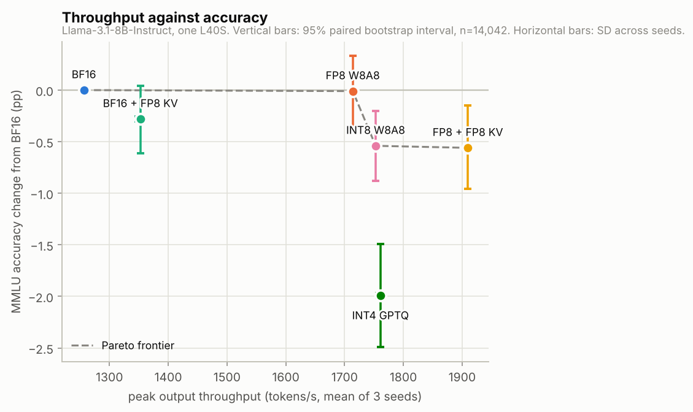
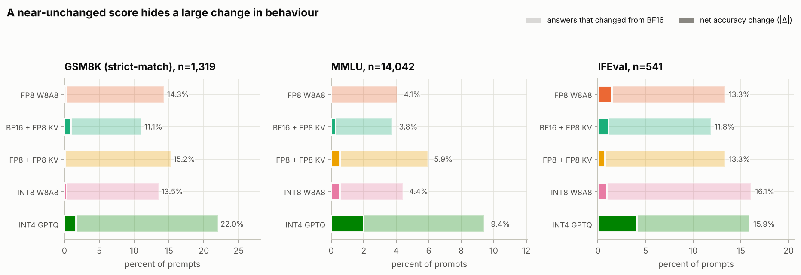
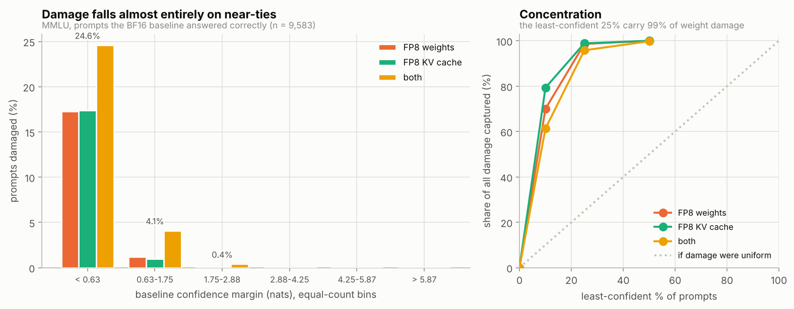

# What a quantized model actually changes

### A controlled measurement of six precision configurations for Llama-3.1-8B-Instruct

**Manan Jindal** — Department of Electrical Engineering, IIT Kanpur\
November 2026 · `github.com/mananj23/llm-precision-study`

---

## Summary

Quantization is normally reported as a single number: a model's accuracy on a
benchmark, before and after. This study measures what that number hides.

Six precision configurations of Llama-3.1-8B-Instruct were served on one NVIDIA
L40S under identical conditions and evaluated on GSM8K (n = 1,319), MMLU
(n = 14,042), IFEval (n = 541) and LongBench (n = 4,750, up to 20,480 tokens),
with per-prompt outcomes recorded for every configuration, and a throughput grid
of 216 measured cells. Four results:

1. **The measurement floor is exactly zero.** The BF16 baseline was evaluated
   twice, 17 hours apart, on the same hardware. All 1,319 extracted answers were
   byte-identical and all 1,319 correctness outcomes agreed. Every difference
   reported below is therefore a real effect of precision and not run-to-run
   variation — a claim most quantization papers assert rather than measure.

2. **A near-unchanged score hides a large change in behaviour — but the change
   is confined to the model's near-ties.** FP8 weights with an FP8 KV cache
   score 70.43% on GSM8K against the baseline's 70.51%, a gap of one question
   in 1,319, while **15.2% of the answers change**. On MMLU, where the model's
   per-choice confidence is recoverable, that churn turns out to be almost
   perfectly concentrated: **the least-confident quarter of prompts carries
   98.6% of all weight-quantization damage**, and over the two-thirds of
   prompts with a confidence margin above 1.75 nats, FP8 weights damaged
   **1 prompt out of 6,397** and the FP8 KV cache damaged **none**. Quantization
   does not degrade confident predictions here; it reshuffles the coin-flips.

3. **Two quantizations compose additively in aggregate — but a popular way of
   measuring that says otherwise, and it is wrong.** Measured on a *damage set*
   (prompts the baseline got right, counting only losses), combining FP8 weights
   with an FP8 KV cache looks strongly sub-additive: 10.9% damaged against 17.9%
   predicted by independence, resolved on three tasks. Measured by the standard
   symmetric 2 × 2 interaction contrast, which counts gains as well as losses
   and needs no conditioning, **the interaction is unresolved on all four
   tasks**. The damage-set construction selects for prompts the baseline
   answered luckily, and regression to the mean then masquerades as structure —
   a reading §4.6 confirms independently. What does not compose is not the
   score; it is *which prompts change*.

4. **Aggressive quantization trades instruction-following for pattern-copying.**
   INT4 GPTQ almost never fails to emit the answer format its 5-shot exemplars
   demonstrate — a format-miss rate of **0.91% against the baseline's 7.35%**
   (−6.44 pp, CI [−7.88, −5.00]) — while scoring **4.07 pp worse on IFEval**
   (CI [−7.39, −0.74]), which tests compliance with instructions given in prose.
   Both effects are resolved; every 8-bit scheme is indistinguishable from BF16
   on both. The model becomes more bound to the surface form in its context and
   less able to follow an instruction stated in words.

That last pair also constrains how any quantization result can be compared with
published figures. On GSM8K, INT4 GPTQ's accuracy delta is **+1.67 pp under
lm-eval's `strict-match` filter and −4.78 pp under `flexible-extract`**, from
the identical model outputs — because strict extraction rewards exactly the
format-copying that §4.3 shows INT4 gains. Only the second is statistically
resolved, but a paper reporting either alone — and most report one, without
naming which — tells a different story about the same run.

---

## 1. The question

Quantization reduces the numerical precision of a model's weights, its
activations, or its KV cache, trading arithmetic exactness for memory and speed.
The published evidence for a given scheme is almost always a table of benchmark
accuracies with the deltas from full precision. That design can answer "does the
score move?" It cannot answer three questions a practitioner actually has:

- **Is the measured delta larger than the noise?** Benchmark evaluation is not
  deterministic by default. Batching, kernel selection, and sampling all
  introduce variation. A reported 0.3-point drop is meaningless without knowing
  the spread of a repeated identical run, which is rarely reported.
- **Do the same inputs still get the same answers?** An unchanged aggregate is
  consistent with no change at all, and equally consistent with a large
  two-way churn that happens to balance.
- **Do schemes compose?** Weight quantization and KV-cache quantization are
  routinely stacked. Whether their effects add, cancel, or interact is an
  empirical question that a table of single-scheme deltas cannot address.

This study was designed around those three questions rather than around a
ranking of schemes.

## 2. Design

**Pre-registration.** The configuration grid, the evaluation tasks, the sample
sizes, the baseline, and the statistical test were written down and committed
before the GPU was rented. The analysis code was validated against synthetic
fixtures with known structure before it saw real data. This matters because the
effects here are small: with n = 1,319 the minimum detectable effect on GSM8K is
roughly ±2 pp, which is wider than most of the differences measured, and an
analysis chosen after seeing the data could easily manufacture a finding.

**Per-prompt outcomes.** Every evaluation records the outcome of every
individual document, not just the aggregate. All the behavioural results in this
report follow from that choice, and none of them are recoverable from a score
table.

**Paired bootstrap.** Configurations are compared on the same prompts, so the
test resamples prompt indices and averages the per-prompt *differences*
(10,000 resamples, seed 20261116). This is strictly tighter than comparing two
independent accuracy estimates and makes the pairing impossible to get wrong.
A comparison whose 95% interval contains zero is reported as unresolved and is
not ranked.

**Noise floor.** The baseline is evaluated twice, separated by a full day of
other work on the same GPU, with everything else held fixed. The disagreement
between those two runs is the floor every other claim must clear.

**Isolation.** Prefix caching is disabled for all benchmarks. One configuration
occupies the GPU at a time; the harness refuses to start if another server holds
memory. Each throughput cell is measured at three seeds.

## 3. Setup

| | |
|---|---|
| Model | `meta-llama/Llama-3.1-8B-Instruct` |
| GPU | 1 × NVIDIA L40S, 48 GB, compute capability 8.9, driver 550.127.08 |
| Serving | vLLM 0.32.0, PyTorch 2.13.0+cu129, Transformers 5.19.0 |
| Evaluation | lm-evaluation-harness 0.4.13, greedy decoding (`temperature=0`) |
| Quantization | llm-compressor (FP8 dynamic; SmoothQuant 0.8 + GPTQ W8A8; GPTQ W4A16) |
| Tasks | GSM8K 5-shot (n = 1,319); MMLU, 57 subtasks (n = 14,042); IFEval (n = 541); LongBench, 21 subtasks (n = 4,750) |
| Throughput | 3 input/output shapes × 4 concurrencies × 3 seeds × 6 configs = 216 cells |

Compute capability 8.9 is the gate for hardware FP8 W8A8 on this generation;
the L40S clears it. Every run records a provenance file with the git commit,
package versions, GPU identity, and the exact command line.

The six configurations are BF16/BF16 (baseline), FP8 weights with a BF16 KV
cache, BF16 weights with an FP8 KV cache, FP8 weights with an FP8 KV cache,
INT8 W8A8 weights, and INT4 GPTQ weights. The first four form a 2 × 2 factorial
design in *weight precision* × *KV precision*, which is what makes the
composition analysis in §4.5 possible.

An INT4 AWQ configuration was specified but never built: the installed
llm-compressor exposes `AWQModifier` as a factory function rather than a class,
and the substitute path did not produce a valid checkpoint within the GPU budget.
It is reported as absent rather than quietly dropped.

## 4. Results

### 4.1 The floor is zero

The BF16 baseline was evaluated on GSM8K at 21:14 on 25 November and again at
14:36 on 26 November — 17 hours and 22 minutes apart, on the same GPU, with a
day of quantization and benchmarking work in between.

| | run A | run B |
|---|---|---|
| accuracy | 70.508% | 70.508% |
| per-prompt correctness disagreement | — | **0.000%** |
| per-prompt extracted-answer disagreement | — | **0.000%** |

Not one of the 1,319 extracted answers differed. Under greedy decoding with a
fixed seed and a fixed server configuration, this pipeline is deterministic to
the character.

This is the result that makes the rest of the report possible. A 0.9-point
difference between two configurations means nothing if repeating one of them
moves it by 0.9 points. Here, repeating it moves it by nothing, so every
difference below is attributable to precision.

### 4.2 Accuracy



**MMLU** (n = 14,042). Three of five comparisons are resolved.

| configuration | accuracy | Δ vs BF16 | 95% CI | resolved |
|---|---:|---:|---|---|
| BF16 / BF16 | 68.25% | — | — | — |
| FP8 W8A8 / BF16 KV | 68.23% | −0.01 | [−0.35, +0.33] | no |
| BF16 / FP8 KV | 67.96% | −0.28 | [−0.61, +0.04] | no |
| FP8 W8A8 / FP8 KV | 67.69% | −0.56 | [−0.96, −0.15] | **yes** |
| INT8 W8A8 / BF16 KV | 67.70% | −0.54 | [−0.88, −0.20] | **yes** |
| INT4 GPTQ / BF16 KV | 66.25% | −1.99 | [−2.49, −1.49] | **yes** |

**GSM8K** (n = 1,319, `strict-match`). **None** of the five comparisons are
resolved: every interval contains zero.

| configuration | accuracy | Δ vs BF16 | 95% CI | resolved |
|---|---:|---:|---|---|
| BF16 / BF16 | 70.51% | — | — | — |
| FP8 W8A8 / BF16 KV | 70.28% | −0.23 | [−2.27, +1.82] | no |
| BF16 / FP8 KV | 69.60% | −0.91 | [−2.73, +0.91] | no |
| FP8 W8A8 / FP8 KV | 70.43% | −0.08 | [−2.20, +2.05] | no |
| INT8 W8A8 / BF16 KV | 70.20% | −0.30 | [−2.35, +1.67] | no |
| INT4 GPTQ / BF16 KV | 72.18% | +1.67 | [−0.83, +4.25] | no |

**IFEval** (n = 541, `prompt_level_strict_acc`). One of five resolved.

| configuration | accuracy | Δ vs BF16 | 95% CI | resolved |
|---|---:|---:|---|---|
| BF16 / BF16 | 47.32% | — | — | — |
| FP8 W8A8 / BF16 KV | 45.84% | −1.48 | [−4.62, +1.66] | no |
| BF16 / FP8 KV | 46.21% | −1.11 | [−3.88, +1.85] | no |
| FP8 W8A8 / FP8 KV | 48.06% | +0.74 | [−2.40, +3.70] | no |
| INT8 W8A8 / BF16 KV | 46.40% | −0.92 | [−4.25, +2.40] | no |
| INT4 GPTQ / BF16 KV | 43.25% | −4.07 | [−7.39, −0.74] | **yes** |

The contrast between the three tables is itself a finding about evaluation
practice. GSM8K is the benchmark quantization papers reach for most often, and
at its full size it cannot separate any of these configurations. IFEval, at
n = 541, separates only the 4-bit scheme. MMLU, twenty-six times larger than
IFEval, separates three. A GSM8K-only comparison of FP8 against INT8 against
INT4 has no statistical content at this effect size, however confidently the
numbers are tabulated — and the one configuration every task agrees on is the
one with the largest effect.

### 4.3 The answer depends on which extractor you use

lm-evaluation-harness scores GSM8K under two filters. `strict-match` requires
the model to emit its answer in the format the prompt requested;
`flexible-extract` pulls the last number out of the response whatever the
format. Both report under the metric name `exact_match`. The same generated
text, scored both ways:

| configuration | Δ `strict-match` | 95% CI | Δ `flexible-extract` | 95% CI |
|---|---:|---|---:|---|
| FP8 W8A8 / BF16 KV | −0.23 | [−2.27, +1.82] | −0.23 | [−1.90, +1.52] |
| BF16 / FP8 KV | −0.91 | [−2.65, +0.83] | −0.61 | [−2.12, +0.91] |
| FP8 W8A8 / FP8 KV | −0.08 | [−2.12, +2.05] | −0.83 | [−2.50, +0.91] |
| INT8 W8A8 / BF16 KV | −0.30 | [−2.35, +1.67] | −0.08 | [−1.74, +1.52] |
| **INT4 GPTQ / BF16 KV** | **+1.67** | [−0.91, +4.25] | **−4.78** | **[−7.05, −2.58]** |

For the 8-bit schemes the choice of filter barely matters. For INT4 GPTQ it
reverses the sign of the headline number: a 6.45-point swing between two ways of
reading the same outputs.

**What can and cannot be claimed about the sign.** The flexible-extract
degradation is resolved. The strict-match improvement is *not* — its interval
contains zero — so this is not a demonstrated sign flip, and it would be
overreach to call it one. What is demonstrated is weaker and still
consequential: **the two filters disagree about the direction of the INT4
effect, and a paper that reports one filter without naming it gives a reader no
way to know which story they are being told.** Both are reported here, and the
repository ships both.

**What drives the gap is resolved, and it is not what it looks like.** Define a
*format miss* as a prompt the model answers correctly under flexible extraction
and incorrectly under strict — it reached the right number and did not emit it
in the `#### N` form its five exemplars demonstrate. This is measured per
prompt and compared paired, like everything else:

| configuration | format-miss rate | Δ vs BF16 | 95% CI | resolved |
|---|---:|---:|---|---|
| BF16 / BF16 | 7.35% | — | — | — |
| FP8 W8A8 / BF16 KV | 7.35% | +0.00 | [−1.36, +1.36] | no |
| BF16 / FP8 KV | 7.66% | +0.30 | [−0.91, +1.52] | no |
| FP8 W8A8 / FP8 KV | 6.60% | −0.76 | [−2.20, +0.68] | no |
| INT8 W8A8 / BF16 KV | 7.58% | +0.23 | [−1.14, +1.59] | no |
| INT4 GPTQ / BF16 KV | **0.91%** | **−6.44** | **[−7.88, −5.00]** | **yes** |

INT4 GPTQ has all but eliminated format misses. Every 8-bit scheme is
indistinguishable from the baseline. The obvious reading is that 4-bit
quantization makes the model better at following the output-format instruction.

**IFEval rules that reading out.** IFEval tests compliance with instructions
stated in prose — write in lowercase, use exactly three bullet points, wrap the
answer in quotes — with no exemplars to copy. On IFEval, INT4 GPTQ is 4.07 pp
*worse* than the baseline, resolved (§4.2). The two measurements point in
opposite directions, and both are resolved.

What distinguishes them is where the format comes from. GSM8K's `#### N` is
demonstrated five times in the context; IFEval's constraints are described once
in words. So the measurements are consistent with INT4 quantization shifting
the model toward **copying the surface form present in its context** and away
from **executing an instruction stated in prose**. That is an interpretation of
two resolved effects, not a third measurement: this experiment does not isolate
in-context copying as a mechanism, and a clean test would vary the number of
exemplars and watch the format-miss rate respond. It is offered as the most
economical account of the pair, and flagged as untested.

The practical consequence does not depend on which account is right. A
quantized model can improve on a benchmark whose answer format is demonstrated
in-context while getting worse at the instruction-following that most deployed
systems actually rely on, and a single accuracy number will show the first and
hide the second.

### 4.4 The score is stable; the behaviour is not



For each configuration, the fraction of prompts whose correctness differs from
the baseline, set against the net accuracy change:

| configuration | GSM8K changed | net Δ | MMLU changed | net Δ | IFEval changed | net Δ |
|---|---:|---:|---:|---:|---:|---:|
| FP8 W8A8 | 14.33% | −0.23 | 4.07% | −0.01 | 13.31% | −1.48 |
| BF16 + FP8 KV | 11.07% | −0.91 | 3.77% | −0.28 | 11.83% | −1.11 |
| FP8 + FP8 KV | 15.24% | −0.08 | 5.93% | −0.56 | 13.31% | +0.74 |
| INT8 W8A8 | 13.50% | −0.30 | 4.39% | −0.54 | 16.08% | −0.92 |
| INT4 GPTQ | 21.99% | +1.67 | 9.43% | −1.99 | 15.90% | −4.07 |

The FP8/FP8 row is the clearest case. Its GSM8K score is within one question of
the baseline, and 15.24% of its answers are different; on IFEval it scores
*above* the baseline while changing 13.31% of its answers. Because the floor is
zero, none of that churn is noise.

The underlying counts show why the aggregate holds still. Against the baseline
on GSM8K, FP8/FP8 breaks 101 prompts the baseline answered correctly and fixes
100 that the baseline answered incorrectly. On MMLU it breaks 455 and fixes 377.
The net is small because the two flows are comparable in size, not because
little happened.

For anyone deploying a quantized model this is the operative fact. A validation
suite that reports aggregate accuracy will show FP8/FP8 as equivalent to BF16.
One user in seven will get a different answer to a GSM8K-style question than
they would have before.

### 4.5 Does the damage compose? Two framings disagree

The 2 × 2 design isolates the question directly, and it turns out the answer
depends on how "damage" is defined. Both analyses are reported, because the
disagreement between them is the finding.

**Framing A: the damage set.** Define *damage* as a prompt the baseline answers
correctly and a variant does not, as a fraction of the 930 GSM8K prompts (9,583
MMLU, 256 IFEval) the baseline answers correctly. Compare the combination
against an independence model over the two components.

| | GSM8K (strict) | MMLU | IFEval |
|---|---:|---:|---:|
| baseline-correct prompts | 930 | 9,583 | 256 |
| damaged by FP8 weights alone | 10.32% (96) | 2.99% (287) | 15.62% (40) |
| damaged by FP8 KV alone | 8.49% (79) | 2.97% (285) | 13.67% (35) |
| damaged by either (union) | 15.38% (143) | 5.07% (486) | 21.88% (56) |
| **predicted if independent** | **17.94%** | **5.88%** | **27.16%** |
| **measured for the combination** | **10.86% (101)** | **4.75% (455)** | **13.28% (34)** |
| excess over independence | −7.08 pp | −1.13 pp | −13.88 pp |
| 95% CI on the excess | [−9.54, −4.48] | [−1.65, −0.63] | [−19.25, −8.21] |
| Jaccard overlap of the damage sets | 0.224 | 0.177 | 0.339 |

By this measure the combination is markedly *less* damaging than independence
predicts, resolved on all three tasks, and the structure beneath it is not a
simple overlap — the two single-component damage sets are mostly disjoint:

| | GSM8K | MMLU | IFEval |
|---|---:|---:|---:|
| single-component failures **repaired** by the combination | 83 of 143 (58.0%) | 251 of 486 (51.6%) | 32 of 56 (57.1%) |
| combination failures that are **new** | 41 of 101 (40.6%) | 220 of 455 (48.4%) | 10 of 34 (29.4%) |

**Framing B: the symmetric interaction.** The damage set conditions on the
baseline being correct and counts only losses. That is a strong assumption, and
§4.4 already showed why it is a risky one: the recoveries are comparable in size
to the losses, and ignoring them discards half the signal. The standard contrast
for a 2 × 2 factorial makes no such choice. Per prompt,

$$I = \text{score}_C - \text{score}_W - \text{score}_K + \text{score}_{base}$$

averaged over prompts, with a paired bootstrap. $I = 0$ means the two effects
are exactly additive. It is symmetric in gains and losses, needs no
conditioning, and works unchanged on a continuous score.

| task | n | Δ weights | Δ KV | Δ both | additive prediction | interaction | 95% CI | resolved |
|---|---:|---:|---:|---:|---:|---:|---|---|
| GSM8K (strict) | 1,319 | −0.23 | −0.91 | −0.08 | 69.37% | +1.06 | [−1.74, +3.87] | no |
| MMLU | 14,042 | −0.01 | −0.28 | −0.56 | 67.95% | −0.26 | [−0.74, +0.21] | no |
| IFEval | 541 | −1.48 | −1.11 | +0.74 | 44.73% | +3.33 | [−1.11, +7.76] | no |
| LongBench | 4,750 | +0.32 | −0.01 | +0.27 | 43.95% | −0.04 | [−0.62, +0.56] | no |

**Not one of the four is resolved.** On the symmetric measure, FP8 weight
quantization and FP8 KV quantization compose additively as far as this
experiment can detect, including on LongBench, where the binary damage model
does not apply at all and a continuous score is the only option.

**Reconciling them.** Framing A's sub-additivity is substantially an artifact of
its own conditioning. Selecting prompts the baseline answered correctly selects,
among other things, prompts where the baseline was lucky; any perturbation
regresses those toward their expected outcome, which registers as "damage" for a
single component and as "repair" when a second perturbation moves them back.
§4.6 confirms the mechanism independently: the damage sits almost entirely at
the model's decision boundary, which is exactly where regression to the mean
operates. A study reporting Framing A alone — and the damage-set construction is
a natural one to reach for — would describe coin-flips as structure.

**What survives.** Not "the effects interact." What survives is weaker and still
worth stating: the *aggregate* composes additively, while the *set of prompts
affected* is substantially rebuilt, and nothing in the component measurements
predicts which prompts those are. If the quantity you care about is a benchmark
score, component measurements suffice. If it is which inputs change behaviour,
they do not.

### 4.6 Where the damage falls



MMLU is scored by comparing per-choice log-likelihoods, and the evaluation
logged them, so for every one of the 14,042 documents there is a **confidence
margin**: the gap in nats between the model's best and second-best choice. That
makes the question in §4.5 answerable. Binning the 9,583 prompts the baseline
answers correctly into six equal-count margin bins:

| baseline margin (nats) | n | damaged by FP8 W | by FP8 KV | by both |
|---|---:|---:|---:|---:|
| < 0.63 | 1,543 | 17.3% | 17.4% | 24.6% |
| 0.63 – 1.75 | 1,643 | 1.2% | 1.0% | 4.1% |
| 1.75 – 2.88 | 1,602 | 0.1% | 0.0% | 0.4% |
| 2.88 – 4.25 | 1,599 | 0.0% | 0.0% | 0.1% |
| 4.25 – 5.87 | 1,598 | 0.0% | 0.0% | 0.0% |
| > 5.87 | 1,598 | 0.0% | 0.0% | 0.0% |

The concentration is extreme. The least-confident 25% of prompts carry **98.6%**
of all FP8-weight damage, **98.9%** of all FP8-KV damage and **95.8%** of the
combination's. Above 1.75 nats — 6,397 prompts, two-thirds of the baseline-
correct set — FP8 weights damage **one** prompt, the FP8 KV cache damages
**zero**, and the combination damages **seven**.

**This answers §4.5, mostly in favour of the second reading.** The "repair" of
over half the single-component damage is largely regression to the mean: the
prompts being repaired are ones where the model was nearly indifferent, and a
perturbation that re-flips them is not recovering anything. A study that
reported the §4.5 table without conditioning on confidence would be describing
coin-flips as structure.

**A residual does not fit that account.** In the 0.63–1.75 band the components
damage 1.2% and 1.0%, so independence predicts 2.2% — and the combination
damages 4.1%, which is super-additive, the opposite sign to the aggregate
result. The pattern persists in the next bin (0.1%, 0.0%, 0.4%) and above
1.75 nats (one prompt, zero prompts, seven). The direction is consistent across
three bins, but seven prompts will not support a statistical claim, and the
formal test is reported as **not evaluable** rather than dressed up: above every
threshold tried, neither single component damages as much as 0.2% of prompts, so
the ratio has no denominator. The honest statement is that confident prompts are
essentially untouched by either component, that the combination touches a few
more than either, and that the sample is too small to say more.

**The practical consequence is the useful part.** If an application's decisions
rest on predictions the model is confident about, FP8 quantization is close to
free here — not "a 0.56-point cost spread over everything", but *no measurable
cost at all on two-thirds of inputs, concentrated entirely on the rest*. If an
application routinely operates where the model is near-indifferent, aggregate
accuracy is the wrong thing to validate on, because that is exactly the
population the churn lands in.

This analysis is MMLU-only. GSM8K and IFEval are generative tasks with no
per-choice likelihood to difference, so the same question cannot be asked of
them here; a follow-up could use sequence log-probability as a proxy.

### 4.7 Long context

LongBench was evaluated on the four configurations that isolate the KV contrast,
at `max_model_len=20480`, 4,750 documents across 21 subtasks. Its metric is a
per-document score in [0, 1] — F1, ROUGE or accuracy depending on subtask — and
62% of the scores fall strictly between 0 and 1, so this task is scored on a
continuous scale rather than a binary one.

| configuration | mean score | Δ vs BF16 | 95% CI | resolved | documents changed | mean abs. change |
|---|---:|---:|---|---|---:|---:|
| BF16 / BF16 | 43.64% | — | — | — | — | — |
| FP8 W8A8 / BF16 KV | 43.97% | +0.32 | [−0.12, +0.78] | no | 42.67% | 5.15 |
| BF16 / FP8 KV | 43.63% | −0.01 | [−0.40, +0.37] | no | 39.31% | 4.13 |
| FP8 W8A8 / FP8 KV | 43.92% | +0.27 | [−0.22, +0.76] | no | 46.42% | 6.00 |

Two things stand out, and the first is a negative result against a reasonable
prior.

**The FP8 KV cache costs nothing measurable at long context — the smallest
effect of any configuration on any task in this study (−0.01 pp).** The
expectation going in was the opposite: a quantized KV cache stores every past
token, so its error should compound with context length, and long context is
where it should hurt most. At up to 20,480 tokens it does not. That is worth
stating plainly because it is the kind of prediction that usually goes
unreported when it fails.

**The churn is the largest in the study.** Between 39% and 46% of documents
receive a different score, with a mean absolute change of 4 to 6 points, while
every aggregate difference is statistically indistinguishable from zero. The
caveat is that a continuous metric registers any change: a one-token difference
in a summary moves ROUGE slightly, so "changed" is a weaker claim here than on a
binary task. The mean absolute change of 4–6 score points is the more meaningful
figure, and it is not small.

This is §4.4's finding in its most extreme form. On a generative long-context
task, nearly half the outputs are measurably different and the benchmark cannot
tell.

### 4.8 Throughput

216 cells: 6 configurations × 3 shapes × 4 concurrencies (1, 8, 32, 64) × 3
seeds. Peak output throughput, and the KV cache capacity vLLM reports at
startup:

| configuration | peak output tok/s | speedup | KV cache tokens |
|---|---:|---:|---:|
| FP8 W8A8 / FP8 KV | 1,909.7 | 1.52× | 491,904 |
| INT4 GPTQ / BF16 KV | 1,761.0 | 1.40× | 269,584 |
| INT8 W8A8 / BF16 KV | 1,752.9 | 1.40× | 242,336 |
| FP8 W8A8 / BF16 KV | 1,713.9 | 1.36× | 248,832 |
| BF16 / FP8 KV | 1,352.7 | 1.08× | 389,824 |
| BF16 / BF16 | 1,256.5 | 1.00× | 191,264 |

The KV cache figures are a check on the serving stack rather than a result.
Llama-3.1-8B uses grouped-query attention with 8 KV heads of dimension 128 over
32 layers, so one token of KV cache in 16-bit occupies 2 × 32 × 8 × 128 × 2 =
128 KiB. Predicting the available cache from the reported free memory gives
≈191,000 tokens against the 191,264 vLLM reports — under 1% error, which
confirms the cache is configured as intended and that the FP8 KV cache is
genuinely halving the per-token footprint (389,824 ≈ 2 × 191,264).

Read against §4.2, the frontier is undramatic. FP8/FP8 gives 1.52× throughput
for a resolved but small MMLU cost of 0.56 pp. INT4 GPTQ gives *less*
throughput than FP8/FP8 on this hardware while costing 1.99 pp — on an L40S,
where FP8 has hardware support and W4A16 must dequantize to compute, the 4-bit
scheme is dominated on both axes. Its advantage is memory footprint, which
matters on smaller cards and is not what this grid measures.

## 5. What this means

For practitioners:

- **Measure your floor before you believe your delta.** It costs one repeated
  evaluation. Without it, a sub-point difference is uninterpretable.
- **GSM8K cannot resolve 8-bit quantization effects.** At n = 1,319 the
  minimum detectable effect is wider than the effects, and IFEval at n = 541 is
  worse. Published GSM8K deltas of under two points between quantization
  schemes are not evidence of a difference.
- **Say which extraction filter you used.** On this model the choice moves the
  INT4 headline by 6.45 points and disagrees about its direction, because
  strict extraction rewards the in-context format-copying that 4-bit
  quantization happens to strengthen.
- **Test instruction-following separately from accuracy.** They move in
  opposite directions here. A 4-bit model that looks unchanged or better on a
  few-shot benchmark is measurably worse at obeying instructions given in
  prose, which is how most deployed systems are actually driven.
- **Validate the configuration you will actually serve — for behaviour, not for
  score.** The aggregate composes additively: if all you need is a benchmark
  number for a stacked configuration, measuring the components is enough. What
  does not follow from the components is *which* inputs change, and an unchanged
  score does not mean unchanged behaviour — up to one answer in seven changes
  here on GSM8K with the score held still, and nearly one document in two on
  LongBench.
- **Be suspicious of damage-set analyses, including your own.** Conditioning on
  what the baseline got right and counting only losses produced a clean,
  replicated, statistically resolved result in this study that the symmetric
  contrast does not support. Any metric that conditions on a baseline outcome
  inherits regression to the mean.
- **Ask where your application sits on the confidence distribution.** On MMLU
  the entire cost of FP8 falls on the least-confident quarter of inputs, and
  two-thirds of inputs are untouched. Whether that makes quantization free or
  expensive depends on which part of that distribution your traffic lives in —
  and an aggregate benchmark score cannot tell you, because it averages over
  both.

For evaluation practice, the general point is that an aggregate benchmark score
is a lossy summary of a model's behaviour, and quantization is precisely the
regime where the loss bites: the aggregate is designed to be preserved, and the
per-prompt behaviour is not. Releasing per-prompt outcomes costs nothing and
makes the difference visible. This repository releases them.

## 6. Limitations

Stated plainly, because several of them bound the claims above.

- **One model, one family.** Llama-3.1-8B-Instruct only. Nothing here
  establishes that the composition structure generalizes. A Qwen2.5-7B
  replication grid is specified in the repository and not yet run; it is the
  single most valuable next experiment and it is cheap.
- **One GPU.** All results are L40S. The throughput ordering in particular is
  hardware-specific — the INT4-versus-FP8 conclusion would likely differ on a
  card without FP8 support.
- **Long context is capped at 20,480 tokens.** LongBench documents longer than
  that are truncated by the harness, so §4.7's null result for the FP8 KV cache
  is a statement about context up to 20K tokens, not about arbitrarily long
  context. The compounding that was expected may simply begin further out.
- **LongBench's metric is continuous**, so its "documents changed" figure counts
  any change at all, including a one-token difference in a summary. The mean
  absolute change is the figure to read.
- **IFEval is small.** At n = 541 it resolves only the 4-bit effect. The IFEval
  composition result in §4.5 rests on 256 baseline-correct prompts and its
  interval is correspondingly wide; it agrees with the other two tasks in
  direction and magnitude, which is the weight it should be given.
- **INT4 AWQ missing**, for the reason given in §3.
- **Deterministic, greedy decoding only.** The zero floor is a property of this
  configuration. Under sampling, or with prefix caching enabled, or with
  continuous batching across variable loads, the floor would not be zero, and
  the churn measured in §4.4 would be partly confounded with it. The claim is
  that precision causes the churn *under determinism*, which is the regime the
  experiment controls.
- **The confidence analysis is MMLU-only and uses one definition of
  confidence.** The margin between the top two choice log-likelihoods is a
  reasonable proxy and it is not calibrated probability; a model can be
  confidently wrong. §4.6's claim is about where *changes* land relative to the
  baseline's own certainty, not about correctness.
- **The residual super-additivity in §4.6 rests on single-digit counts** and is
  reported as a direction, not a result.
- **No statistical correction across the comparison family.** Fifteen paired
  comparisons are reported. At α = 0.05 some resolved results could be chance;
  the three resolved MMLU effects have intervals far from zero and are unlikely
  to be, but this is noted rather than corrected.

## 7. Reproduction

```bash
git clone https://github.com/mananj23/llm-precision-study
cd llm-precision-study
./scripts/env_check.sh          # refuses to proceed on a mismatched stack
./scripts/run_all.sh            # build, verify, evaluate, benchmark
python3 analysis/report_tables.py   # every number in this report
python3 analysis/plot_report.py     # every figure in this report
```

The repository ships per-prompt outcomes for all six configurations on both
tasks (`results/logs/per_prompt.parquet`), all 216 throughput cells
(`results/logs/system.parquet`), a provenance record per run, and the full
console logs including the failures.

Two notes on the analysis path, both of which changed numbers in this report and
are the kind of thing that normally goes unrecorded:

**The filter column.** The collection script wrote one row per (document,
filter) without recording which filter, giving 2,638 indistinguishable rows per
GSM8K configuration. A dedupe that keeps one row per document can silently
retain `strict-match` for one configuration and `flexible-extract` for another,
which fabricates a difference of several points. `analysis/load.py` recovers the
filters from lm-eval's filter-major output order and then **proves** the
recovery by checking each block against the accuracy table lm-eval itself
printed for that run. All seven runs confirm to within 1e-4. The loader raises
rather than returning unverified data.

**The noise floor is a gate, not a statistic.** `analysis/interaction.py`
refuses to interpret the novel-damage fraction unless it is given a measured
floor to compare against. The composition result in §4.5 is only meaningful
because that floor is zero.

---

### References

1. Frantar et al., *GPTQ: Accurate Post-Training Quantization for Generative
   Pre-trained Transformers*, ICLR 2023.
2. Xiao et al., *SmoothQuant: Accurate and Efficient Post-Training Quantization
   for Large Language Models*, ICML 2023.
3. Lin et al., *AWQ: Activation-aware Weight Quantization for LLM Compression
   and Acceleration*, MLSys 2024.
4. Kwon et al., *Efficient Memory Management for Large Language Model Serving
   with PagedAttention*, SOSP 2023.
5. Gao et al., *A framework for few-shot language model evaluation*
   (lm-evaluation-harness), 2024.
6. Cobbe et al., *Training Verifiers to Solve Math Word Problems* (GSM8K), 2021.
7. Hendrycks et al., *Measuring Massive Multitask Language Understanding*
   (MMLU), ICLR 2021.
